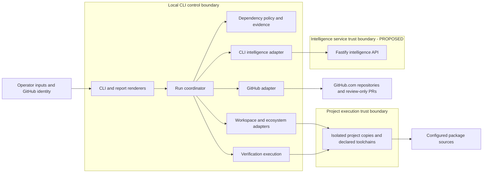

# Trim Reaper Architecture

This document owns how the system is built. [REQUIREMENTS.md](REQUIREMENTS.md) owns behavior; [DESIGN.md](DESIGN.md) owns presentation. This is a planned architecture assuming no implementation exists. `PROPOSED` identifies unconfirmed technical choices, not additional product requirements.

## Required Architecture Inputs

| Field | Input |
| --- | --- |
| Requirements source | `REQUIREMENTS.md` |
| Design source | `DESIGN.md` |
| Target surfaces | Non-interactive developer CLI, plain-text terminal output, Markdown reports, and GitHub pull request descriptions (FR-7.1, FR-6.16, FR-6.17). Developer input additionally requires an intelligence API; no web or mobile application. |
| Runtime and deployment environment | Developer inputs name Node.js and Fastify; their framework/runtime labels are reversed (see AQ-1). CLI execution must support Linux, macOS, and Windows subject to project toolchain support (NFR-1.5). Server hosting and runtime versions: UNKNOWN. |
| Server framework | Fastify is the supplied server technology; developer input literally labels Node.js the “server framework” and Fastify the “server runtime.” Intended mapping TO BE DECIDED (AQ-1). |
| Client framework(s) | CLI tool for DevOps; PROPOSED: Node.js CLI, with CLI parsing library TO BE DECIDED. No frontend framework is required. |
| API style and integration model | Intelligence API required by developer input; PROPOSED: synchronous JSON over HTTP, with a CLI adapter. GitHub.com and Maven, Gradle, dotnet/NuGet, npm, Yarn, and pnpm are required integrations. API contract and service location TO BE DECIDED. |
| Authentication and session model | Existing operator GitHub credentials and repository permissions; no separate user accounts or roles. Intelligence API authentication TO BE DECIDED. PROPOSED: no application login session. |
| Data model and scale expectations | Repository/base revision, build roots, toolchain and command declarations, dependency graphs, candidates, evidence, checks, reports, and publication outcome. Scale expectations UNKNOWN. PROPOSED: local run artifacts; server persistence TO BE DECIDED. |
| Security expectations | Security tool; preserve conservative replacement rules, permission checks, isolated changes, verification gates, and review-only publication. Detailed controls deferred to `SECURITY.md`. |

## Architecture and Decisions

**PROPOSED:** One CLI application owns the run lifecycle and local project execution; one Fastify API supplies dependency-analysis and replacement recommendations. Interpret the supplied technologies as Node.js runtime plus Fastify framework, pending resolution of AQ-1. The API is a developer-requested boundary whose capabilities are not yet specified in the requirements. No database, queue, extra service, or graphical application is justified by the current requirements.

Keep analysis, candidate acceptance, graph comparison, and verification policy in a presentation-independent core. The CLI application coordinates that core through adapters for repository access, ecosystem tools, process execution, and intelligence requests. Keep the API's vendor-specific analysis implementation behind an interface. PROPOSED: the API returns candidate suggestions and supporting evidence; local policy and verification remain authoritative. This limits the service's authority over repositories and credentials, but leaves the required evidence exchange unresolved (AQ-2).

**API:** PROPOSED: request/response JSON is sufficient until workload and latency evidence justify asynchronous jobs. Endpoints, schemas, payload limits, timeouts, failure handling, and versioning are TO BE DECIDED. Do not silently treat API unavailability as a verified analysis result.

**Persistence:** PROPOSED: a local run record and artifacts hold the selected revision, toolchain declarations, resolved graphs, candidate checkpoints, check results, and Markdown report. The isolated working copy owns project changes; GitHub owns branches and pull requests. No shared application database is currently justified. Artifact format, retention, cleanup, and API-side storage are TO BE DECIDED. A run record does not imply resumable execution.

**Authentication:** Use the operator's existing GitHub identity; check repository permissions before changing project files. PROPOSED: keep GitHub credentials in the local integration boundary rather than forwarding them to the intelligence API. API authentication and credential acquisition are TO BE DECIDED; do not introduce separate product accounts or browser sessions without revisiting requirements.

**Presentation:** Terminal and Markdown renderers consume the same run outcome. They enforce DESIGN.md's linear report ordering, exact status labels, untruncated names and results, and color-free terminal text. They do not decide whether a change passed or whether publication is allowed.

## Components and Flows

Statuses describe definition completeness: `SUPPORTED` means directly grounded in the inputs; `PARTIALLY DEFINED` means required responsibility with unresolved mechanics; `TO BE DECIDED` means an unresolved boundary or contract. Components are logical responsibilities, not separate deployments.

| Component / status | Responsibility and business-rule enforcement | Owned data | Requirement trace |
| --- | --- | --- | --- |
| CLI and report presentation — SUPPORTED | Parse non-interactive inputs; render outcomes and PR URL; map outcome to exit status. | Input representation and rendered text/Markdown. | FR-7.1, FR-7.10; FR-8.9; FR-6.10–FR-6.20; FR-9.6; DESIGN.md |
| Run coordinator — SUPPORTED | Gate preflight, baseline, candidate changes, restoration, final checks, and publication. Never continue from an unverified restored state. | Run state, selected revision, accepted/rejected candidates, publication eligibility. | FR-7.2, FR-7.5, FR-7.6; FR-8.4–FR-8.11; FR-9.1–FR-9.6 |
| Dependency policy and evidence core — PARTIALLY DEFINED | Investigate every usage area; retain uncertain uses; enforce replacement/consolidation limits, count thresholds, scope evidence, and deferral of substantial changes. Analysis coverage is unresolved. | Normalized graphs, usage evidence, candidate decisions and retention reasons. | FR-1.3–FR-1.9; FR-2.1–FR-2.3, FR-2.5, FR-2.7–FR-2.11; FR-3.1–FR-3.4, FR-3.7–FR-3.13; FR-4.1–FR-4.3; FR-5.1–FR-5.5 |
| Workspace and ecosystem adapters — PARTIALLY DEFINED | Isolate changes; discover build roots; honor declared versions; use package managers for resolution/removal; apply accepted candidate plans and restore checkpoints. | Working copies, checkpoints, project files and raw tool outputs; project files remain project-owned. | FR-7.6; FR-8.1–FR-8.8; FR-1.6; FR-6.6–FR-6.9; FR-9.2, FR-9.3; NFR-1.5, NFR-1.6 |
| Verification execution — PARTIALLY DEFINED | Execute supplied commands and assertions; collect baseline, candidate, clean-install, performance, and final evidence. Compare two fresh final installations, including integrity values where available. | Check observations, expected/actual results, installation snapshots. Core policy decides acceptance. | FR-1.1, FR-1.2; FR-2.5, FR-2.10; FR-4.4, FR-4.5; FR-5.4, FR-5.5; FR-6.1–FR-6.5, FR-6.19, FR-6.20; FR-8.10–FR-8.12; FR-9.7–FR-9.9; NFR-1.1–NFR-1.4 |
| GitHub integration — SUPPORTED | Validate GitHub.com input/access; publish only coordinator-authorized verified changes to a working branch and one PR; never push to base, approve, or merge. | Credential access, repository metadata, publication receipt or failure. | FR-7.1–FR-7.5, FR-7.7–FR-7.12; FR-6.17 |
| Intelligence API and CLI adapter — TO BE DECIDED | PROPOSED: supply analysis/replacement suggestions; cannot authorize acceptance or publication. | Request/response contract and any retained analysis data TO BE DECIDED. | Developer input only; potential support for FR-1.3, FR-1.4, FR-2.1, FR-2.3, FR-3.1, FR-3.12, FR-5.1 requires contract definition. |

### Main Data Flows

1. **Preflight and baseline:** CLI inputs enter the coordinator. GitHub integration resolves the default or supplied base branch, validates permissions, and obtains the selected revision in an isolated copy. Ecosystem adapters discover all supported roots and report unsupported ones without dependency edits. Validate tools, pinned versions, commands, expected exit codes, and runtime assertions before changes. Record baseline build/test evidence; failed or unavailable required baseline checks stop changes and publication.
2. **Candidate evaluation:** Gather before-graphs and usage evidence across application code, dynamic loading, plugins, configuration, scripts, tests, and build/deployment tooling. PROPOSED: send only the agreed analysis inputs to the intelligence API. Core policy evaluates suggestions, preserves uncertain dependencies, and forbids local replacements for cryptography, authentication, protocol handling, general-purpose parsing, and concurrent coordination (FR-2.9). Apply candidates through ecosystem/workspace adapters and run required checks. On failure or inability to check, undo the candidate and verify the last passing state before proceeding; failed restoration stops publication.
3. **Final evidence:** Verify clean installation, build, tests, representative flows, applicable replacement edge cases, and existing performance checks. Verify manifests, lockfiles, documentation, and existing SBOM against the final graph. Scope changes require existing packaging checks and clean production/runtime checks; absent packaging checks preserve production scope. Compare two fresh installations under the same OS, versions, sources, and configuration; graph/integrity differences or tracked manifest/lockfile mutation fail reproducibility. Public API and runtime compatibility constraints remain acceptance gates, not assumptions inferred solely from a successful build.
4. **Report and publish:** Produce terminal and Markdown reports for every outcome, including blocked and unchanged runs. Only a verified nonempty change set may be pushed to a working branch and opened as one PR with the report as its description. Publication failure produces a failed outcome; no verified changes produces a successful no-PR outcome only if the run otherwise completed verification. Return the PR URL on successful publication. Maintainers review independently; the product never approves or merges its PRs.

### Component and Trust Boundaries

The intelligence boundary below is PROPOSED; its existence comes from developer input. Project code, build scripts, package contents, and API suggestions are inputs to evaluate, not authority to change policy. An isolated working copy prevents edits to the operator's project; it does not by itself sandbox execution. Execution isolation and detailed protections belong in `SECURITY.md`.

Arrows show initiation/dependency direction; adapters return observations to the coordinator. Only the coordinator advances run state; only core policy determines candidate eligibility. Remote GitHub access, package retrieval, service requests, and local project command execution cross distinct trust boundaries. Detailed credential handling, repository-content disclosure, command isolation, and artifact protections are deferred to `SECURITY.md`.

## Dependency Rules

- **DR-1:** Presentation depends on application input/outcome contracts. The coordinator and core never depend on CLI formatting or Markdown rendering.
- **DR-2:** The coordinator depends on the core and adapter interfaces. The core depends only on normalized domain data; it cannot import Fastify, GitHub clients, package-manager implementations, or process execution code.
- **DR-3:** Adapters implement application-owned interfaces and translate external formats to domain records. Adapters do not invoke one another or the coordinator; composition supplies their dependencies. This keeps dependency direction acyclic.
- **DR-4:** The coordinator alone owns lifecycle transitions and publication eligibility; the core alone owns acceptance rules. API suggestions and execution observations cannot bypass either owner. Flow is inputs → evidence → policy decision → authorized effect → recorded outcome.
- **DR-5:** Workspace/ecosystem adapters alone mutate project artifacts; verification executes checks in coordinator-selected copies and reports any resulting mutations. Graph snapshots and check observations become immutable evidence once recorded, rather than shared mutable adapter state.
- **DR-6:** The GitHub adapter alone accesses repository credentials and performs publication. It accepts only a coordinator-authorized final revision/report and returns an outcome; neither presentation nor the intelligence API can publish.
- **DR-7:** Fastify transport depends on service analysis interfaces; vendor-specific implementations depend on those interfaces. The CLI consumes the API contract, not server internals. The service never calls into the CLI or takes ownership of local run state.

## Open Questions

- **AQ-1 — Technology labels:** Developer inputs call Node.js the server framework and Fastify the server runtime. Confirm the proposed conventional mapping: Node.js runtime, Fastify framework. Runtime version, implementation language, CLI parsing library, and distribution mechanism are TO BE DECIDED.
- **AQ-2 — Intelligence contract:** Which required analyses does the API perform, what evidence does it require and return, and can source/configuration data leave the operator environment? Analysis engine/provider, API schemas, service location, authentication, persistence, and failure semantics are TO BE DECIDED. There is no requirement authorizing an external model provider.
- **AQ-3 — Execution environment:** API hosting is UNKNOWN. How are toolchains made available without upgrades, and what execution isolation is required for untrusted repository commands across supported operating systems? Define the enforcement boundary in `SECURITY.md`.
- **AQ-4 — Analysis and transformations:** Which mechanisms provide language-specific usage investigation, safe edits, dynamic-use uncertainty detection, and graph normalization across supported ecosystems? How are existing documentation and SBOM formats recognized and updated? These cannot be replaced by scanner assertions alone.
- **AQ-5 — Verification inputs:** How are per-root commands, expected exits, runtime assertions, optional performance checks, and packaging checks expressed and associated with roots? Required-baseline check selection and sufficient candidate-check coverage are TO BE DECIDED; the documented failure gates remain mandatory.
- **AQ-6 — Run artifacts and restoration:** Local record format, report destination on early failure, checkpoint mechanics, cleanup/retention, and cross-root rollback boundaries are TO BE DECIDED. Reproducibility must preserve the specified OS, toolchains, sources, and configuration.
- **AQ-7 — GitHub access and publication:** Credential discovery, permission preflight mechanics, branch naming, and recovery from partial publication are TO BE DECIDED, including how to avoid a second PR if publication is retried. No separate accounts or product-controlled merges are permitted.
- **AQ-8 — Capacity:** Repository size, graph size, service concurrency, and acceptable analysis duration are UNKNOWN. Establish these before selecting resource limits or introducing additional infrastructure.
