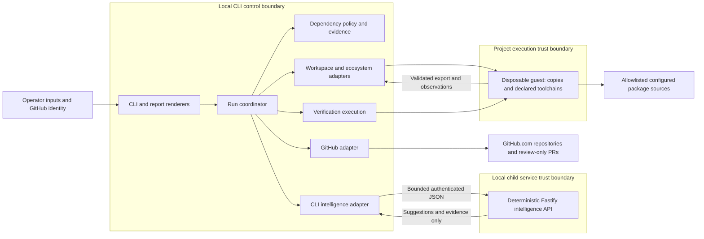

# Trim Reaper Architecture

This document owns how the system is built. [REQUIREMENTS.md](REQUIREMENTS.md) owns behavior; [DESIGN.md](DESIGN.md) owns presentation. This is a planned architecture assuming no implementation exists. The decisions below are normative specification choices selected under the owner’s instruction to resolve open questions; none is implemented or tested.

## Required Architecture Inputs

| Field | Input |
| --- | --- |
| Requirements source | `REQUIREMENTS.md` |
| Design source | `DESIGN.md` |
| Target surfaces | Non-interactive CLI, plain-text terminal, Markdown reports and GitHub pull request descriptions (FR-6.16, FR-6.17); local intelligence API only. |
| Runtime and framework | Node.js 24 runtime; Fastify 5 framework; JavaScript ES modules; npm distribution and native argument parsing. Exact supported patch versions must be pinned when implementation begins (AQ-1). |
| Execution platforms | Linux, macOS and Windows subject to declared project-toolchain support (NFR-1.5); project execution occurs in the matching disposable guest environment (AQ-3). |
| Integration model | GitHub.com; declared Maven, Gradle, dotnet/NuGet, npm, Yarn and pnpm; synchronous versioned JSON to a local child analysis service (AQ-2). |
| Identity | Existing operator GitHub identity; no additional accounts or roles. Local service uses a per-run capability; SECURITY.md OD-002 owns access controls. |
| Persistence | Private local run ledger and snapshots; no service database, remote analysis persistence, queue, or resume capability (AQ-6). |
| Capacity | Finite operator-supplied resource profile required before execution; measured deployment capacities are not yet available (AQ-8). |

## Architecture and Decisions

The CLI owns the run lifecycle. A local Fastify child service supplies deterministic dependency-analysis suggestions. Repository content never leaves the operator’s environment for analysis, and no model provider, generative AI, retrieval system or autonomous agent is authorized. [T-003](THREAT_MODEL.md#t-003), [T-009](THREAT_MODEL.md#t-009), [T-010](THREAT_MODEL.md#t-010) [T-020](THREAT_MODEL.md#t-020)

The presentation-independent core owns analysis policy, candidate acceptance, graph comparison and verification gates. Adapters isolate repository access, ecosystem tools, process execution and service requests. The service has no publication authority, GitHub credentials, project-command execution, or ownership of local run state. [T-002](THREAT_MODEL.md#t-002), [T-012](THREAT_MODEL.md#t-012)

**API contract:** A synchronous version-1 JSON envelope contains a run identifier, immutable input digest, build-root identity, operation, normalized dependency graph and bounded structured usage facts and evidence references (no source text). The only operations are usage investigation, replacement suggestions and graph-reduction suggestions. Responses echo run, root, operation and input digest and return candidate records, evidence references, explicit uncertainties and completion status. Candidate records describe target paths and proposed changes as data; they cannot specify execution commands or policy changes. The local adapter validates both directions and rejects mismatched context, unsupported versions/operations, unknown fields and invalid references. Error responses identify the failed operation with a safe reason and never substitute successful empty analysis. Any required analysis failure blocks affected candidates; a run is not reported verified while a required check remains incomplete. SECURITY.md OD-003 and OD-004 own validation, access, transport and resource mechanics. [T-020](THREAT_MODEL.md#t-020) [T-002](THREAT_MODEL.md#t-002), [T-012](THREAT_MODEL.md#t-012) [T-008](THREAT_MODEL.md#t-008), [T-018](THREAT_MODEL.md#t-018)

**Persistence and authentication:** AQ-6 defines the local ledger and checkpoint model. The GitHub adapter alone obtains credentials and performs publication; SECURITY.md OD-006 and OD-007 own protection, lifecycle and recovery rules. Credentials and policy state remain outside the project execution boundary. [T-003](THREAT_MODEL.md#t-003), [T-009](THREAT_MODEL.md#t-009), [T-010](THREAT_MODEL.md#t-010) [T-005](THREAT_MODEL.md#t-005), [T-019](THREAT_MODEL.md#t-019)

**Presentation:** Terminal and Markdown renderers consume the same immutable outcome. DESIGN.md owns inert, lossless representation and visible redaction; SECURITY.md OD-008 owns rendering security. Renderers never determine acceptance or publication eligibility. [T-004](THREAT_MODEL.md#t-004), [T-013](THREAT_MODEL.md#t-013), [T-014](THREAT_MODEL.md#t-014)

## Components and Flows

All components below are specified responsibilities, not implemented controls. Components are logical responsibilities; the local service and isolated project worker are separate execution boundaries.

| Component / status | Responsibility and business-rule enforcement | Owned data | Requirement trace |
| --- | --- | --- | --- |
| CLI and report presentation — SPECIFIED | Parse non-interactive inputs; render outcomes and PR URL; map outcome to exit status. | Input representation and rendered text/Markdown. | FR-7.1, FR-7.10; FR-8.9; FR-6.10–FR-6.20; FR-9.6; DESIGN.md |
| Run coordinator — SPECIFIED | Gate preflight, baseline, candidate changes, restoration, final checks, and publication. Never continue from an unverified restored state. | Run state, selected revision, accepted/rejected candidates, publication eligibility. | FR-7.2, FR-7.5, FR-7.6; FR-8.4–FR-8.11; FR-9.1–FR-9.6 |
| Dependency policy and evidence core — SPECIFIED | Investigate every usage area; retain uncertain uses; enforce replacement/consolidation limits, count thresholds, scope evidence, and deferral of substantial changes. AQ-4 defines conservative analysis coverage. | Normalized graphs, usage evidence, candidate decisions and retention reasons. | FR-1.3–FR-1.9; FR-2.1–FR-2.3, FR-2.5, FR-2.7–FR-2.11; FR-3.1–FR-3.4, FR-3.7–FR-3.13; FR-4.1–FR-4.3; FR-5.1–FR-5.5 |
| Workspace and ecosystem adapters — SPECIFIED | Isolate changes; discover build roots; honor declared versions; use package managers for resolution/removal; apply accepted candidate plans and restore checkpoints. | Working copies, checkpoints, project files and raw tool outputs; project files remain project-owned. | FR-7.6; FR-8.1–FR-8.8; FR-1.6; FR-6.6–FR-6.9; FR-9.2, FR-9.3; NFR-1.5, NFR-1.6 |
| Verification execution — SPECIFIED | Execute supplied commands and assertions; collect baseline, candidate, clean-install, performance, and final evidence. Compare two fresh final installations, including integrity values where available. | Check observations, expected/actual results, installation snapshots. Core policy decides acceptance. | FR-1.1, FR-1.2; FR-2.5, FR-2.10; FR-4.4, FR-4.5; FR-5.4, FR-5.5; FR-6.1–FR-6.5, FR-6.19, FR-6.20; FR-8.10–FR-8.12; FR-9.7–FR-9.9; NFR-1.1–NFR-1.4 |
| GitHub integration — SPECIFIED | Validate GitHub.com input/access; publish only coordinator-authorized verified changes to a working branch and one PR; never push to base, approve, or merge. | Credential access, repository metadata, publication receipt or failure. | FR-7.1–FR-7.5, FR-7.7–FR-7.12; FR-6.17 |
| Intelligence API and CLI adapter — SPECIFIED | Supply deterministic analysis/replacement suggestions through the local versioned contract; cannot authorize acceptance or publication. | Versioned requests/responses held only for the run; no service persistence. | FR-1.3, FR-1.4, FR-2.1, FR-2.3, FR-3.1, FR-3.12, FR-5.1; AQ-2, AQ-4. |

### Main Data Flows

1. **Preflight and baseline:** CLI inputs enter the coordinator. GitHub integration resolves the default or supplied base branch, validates permissions, and obtains the selected revision in an isolated copy. Ecosystem adapters discover all supported roots and report unsupported ones without dependency edits. Validate tools, pinned versions, commands, expected exit codes, and runtime assertions before changes. Record baseline build/test evidence; failed or unavailable required baseline checks stop changes and publication.
2. **Candidate evaluation:** Gather before-graphs and usage evidence across application code, dynamic loading, plugins, configuration, scripts, tests, and build/deployment tooling. Send only validated, minimized analysis inputs to the local intelligence API under AQ-2. Core policy evaluates suggestions, preserves uncertain dependencies, and forbids local replacements for cryptography, authentication, protocol handling, general-purpose parsing, and concurrent coordination (FR-2.9). Apply candidates through ecosystem/workspace adapters and run required checks. On failure or inability to check, undo the candidate and verify the last passing state before proceeding; failed restoration stops publication.
3. **Final evidence:** Verify clean installation, build, tests, representative flows, applicable replacement edge cases, and existing performance checks. Verify manifests, lockfiles, documentation, and existing SBOM against the final graph. Scope changes require existing packaging checks and clean production/runtime checks; absent packaging checks preserve production scope. Compare two fresh installations under the same OS, versions, sources, and configuration; graph/integrity differences or tracked manifest/lockfile mutation fail reproducibility. Public API and runtime compatibility constraints remain acceptance gates, not assumptions inferred solely from a successful build.
4. **Report and publish:** Produce terminal and Markdown reports for every outcome, including blocked and unchanged runs. Only a verified nonempty change set may be pushed to a working branch and opened as one PR with the report as its description. Publication failure produces a failed outcome; no verified changes produces a successful no-PR outcome only if the run otherwise completed verification. Return the PR URL on successful publication. Maintainers review independently; the product never approves or merges its PRs.

### Component and Trust Boundaries

The intelligence boundary is a local child-service boundary. The coordinator checks the mandatory resource profile and execution containment before any project command starts. A disposable guest contains package installation, repository toolchains and checks; no host mounts or GitHub/control-plane credentials cross that boundary. Validated project changes are exported through the workspace adapter. [T-001](THREAT_MODEL.md#t-001), [T-007](THREAT_MODEL.md#t-007), [T-011](THREAT_MODEL.md#t-011), [T-017](THREAT_MODEL.md#t-017) [T-006](THREAT_MODEL.md#t-006) Project code, build scripts, package contents, and API suggestions are inputs to evaluate, not authority to change policy. An isolated working copy prevents edits to the operator's project; it does not by itself sandbox execution. Execution isolation and detailed protections belong in `SECURITY.md` OD-005.

Arrows show initiation/dependency direction; adapters return observations to the coordinator. Only the coordinator advances run state; only core policy determines candidate eligibility. Remote GitHub access, package retrieval, service requests, and local project command execution cross distinct trust boundaries. SECURITY.md OD-002–OD-008 own credential handling, disclosure restrictions, execution containment, safe exports and artifact protections. The project guest cannot reach the CLI control plane or local intelligence service. [T-001](THREAT_MODEL.md#t-001), [T-007](THREAT_MODEL.md#t-007), [T-011](THREAT_MODEL.md#t-011), [T-017](THREAT_MODEL.md#t-017) [T-020](THREAT_MODEL.md#t-020)

## Dependency Rules

- **DR-1:** Presentation depends on application input/outcome contracts. The coordinator and core never depend on CLI formatting or Markdown rendering.
- **DR-2:** The coordinator depends on the core and adapter interfaces. The core depends only on normalized domain data; it cannot import Fastify, GitHub clients, package-manager implementations, or process execution code.
- **DR-3:** Adapters implement application-owned interfaces and translate external formats to domain records. Adapters do not invoke one another or the coordinator; composition supplies their dependencies. This keeps dependency direction acyclic.
- **DR-4:** The coordinator alone owns lifecycle transitions and publication eligibility; the core alone owns acceptance rules. API suggestions and execution observations cannot bypass either owner. Flow is inputs → evidence → policy decision → authorized effect → recorded outcome.
- **DR-5:** Workspace/ecosystem adapters alone mutate project artifacts; verification executes checks in coordinator-selected copies and reports any resulting mutations. Graph snapshots and check observations become immutable evidence once recorded, bound to run, build root, toolchain, command declaration and workspace content digest. Any subsequent mutation invalidates affected verification and publication authorization. [T-008](THREAT_MODEL.md#t-008), [T-018](THREAT_MODEL.md#t-018)
- **DR-6:** The GitHub adapter alone accesses repository credentials and performs publication. It accepts only a coordinator-authorized final revision/report and returns an outcome; neither presentation nor the intelligence API can publish. Immediately before effect, it validates repository identity, base, branch and content digest against the authorization. [T-005](THREAT_MODEL.md#t-005), [T-019](THREAT_MODEL.md#t-019) [T-008](THREAT_MODEL.md#t-008), [T-018](THREAT_MODEL.md#t-018)
- **DR-7:** Fastify transport depends on service analysis interfaces; vendor-specific implementations depend on those interfaces. The CLI consumes the API contract, not server internals. The service never calls into the CLI or takes ownership of local run state.

## Resolved Architecture Decisions

These AQ IDs preserve the original decision history. They are decisions selected under the owner’s instruction, not evidence of implemented controls.

- **AQ-1 — Technology labels:** Node.js is the runtime and Fastify the server framework. Select Node.js 24, Fastify 5 and JavaScript ES modules, npm distribution and native argument parsing. Pin compatible supported patches in the initial runtime manifest and lockfile; release checks verify support and compatibility using the [Node.js release policy](https://github.com/nodejs/Release) and [Fastify LTS policy](https://github.com/fastify/fastify/blob/main/docs/Reference/LTS.md). These selections never upgrade analyzed project toolchains. SECURITY.md OD-001 owns secure-coding pack applicability. [T-001](THREAT_MODEL.md#t-001)
- **AQ-2 — Intelligence contract:** Use only the local child service and versioned contract above. The workspace/ecosystem adapters perform local syntax and manifest inspection and supply structured usage facts to the core. The child service analyzes those normalized facts and dependency graphs to supply evidence-linked suggestions, with no source-text transfer, remote provider or persistent service data. SECURITY.md OD-002–OD-004 own identity, transport and validation. [T-020](THREAT_MODEL.md#t-020) [T-003](THREAT_MODEL.md#t-003), [T-009](THREAT_MODEL.md#t-009), [T-010](THREAT_MODEL.md#t-010)
- **AQ-3 — Execution environment:** The operator provides declared toolchains within a disposable VM matching the selected operating system. No automatic toolchain upgrade is allowed. Preflight fails if the isolation profile in SECURITY.md OD-005 cannot be enforced; an isolated checkout alone is insufficient. Installation comparisons use the same guest OS and declared toolchain/source configuration. [T-001](THREAT_MODEL.md#t-001), [T-007](THREAT_MODEL.md#t-007), [T-011](THREAT_MODEL.md#t-011), [T-017](THREAT_MODEL.md#t-017)
- **AQ-4 — Analysis and transformations:** Use language-aware source traversal, manifest/configuration inspection and package-manager graph output; record evidence for every FR-1.3 usage area. Unknown syntax, unresolved dynamic usage, unsupported edits or missing documentation/SBOM format support retain or defer the affected candidate. Scanners and passing tests alone cannot establish unused status. Transformations operate on recognized syntax and preserve public APIs and runtime compatibility. No general proof of program equivalence is claimed. [T-016](THREAT_MODEL.md#t-016)
- **AQ-5 — Verification inputs:** A versioned JSON declaration associates each build root with command executable, argument array, relative working directory, permitted environment names and expected exit code. Assertions use literal exit, output or file comparisons with explicit expected values. No implicit shell interpretation occurs; an explicitly declared interpreter remains isolated project execution. Run all declared required baseline checks; run every selected root’s declared checks for each candidate, including global checks for cross-root effects. Performance and packaging checks retain their existing conditional requirements. SECURITY.md OD-005 owns process and path safety. [T-001](THREAT_MODEL.md#t-001), [T-007](THREAT_MODEL.md#t-007), [T-011](THREAT_MODEL.md#t-011), [T-017](THREAT_MODEL.md#t-017) [T-008](THREAT_MODEL.md#t-008), [T-018](THREAT_MODEL.md#t-018)
- **AQ-6 — Run artifacts and restoration:** A coordinator-owned versioned JSON ledger stores run identity, inputs, immutable content-addressed observations, candidate state and publication receipts; separate snapshots capture the baseline and whole-workspace checkpoint before every candidate. Restore the whole checkpoint after rejection and reverify before continuing. No automatic resume is supported. Require an operator-specified report path during preflight; if that destination cannot be created, emit the safe terminal summary on standard error and the required safe Markdown report on standard output, return nonzero and do not execute project commands (FR-6.22). SECURITY.md OD-006 owns artifact access, redaction, retention and cleanup. [T-015](THREAT_MODEL.md#t-015) [T-008](THREAT_MODEL.md#t-008), [T-018](THREAT_MODEL.md#t-018) [T-003](THREAT_MODEL.md#t-003), [T-009](THREAT_MODEL.md#t-009), [T-010](THREAT_MODEL.md#t-010)
- **AQ-7 — GitHub access and publication:** The adapter resolves immutable repository identity and base revision, obtains the operator credential through the protected channels defined in SECURITY.md OD-007, and publishes to a fresh run-specific branch. A persisted run identity and receipt reconcile ambiguous remote outcomes before retry, preserving one PR per run. Revalidation immediately before publication binds the effect to the verified bytes, repository and branch. [T-005](THREAT_MODEL.md#t-005), [T-019](THREAT_MODEL.md#t-019) [T-008](THREAT_MODEL.md#t-008), [T-018](THREAT_MODEL.md#t-018)
- **AQ-8 — Capacity:** Require the finite operator resource profile defined by REQUIREMENTS.md FR-8.17 and enforced under SECURITY.md OD-004 and OD-005; no default workload capacity or invented performance target is asserted. Process one candidate worker and one analysis request at a time without an unbounded queue. A limit violation fails the affected required operation; never silently truncate evidence or convert the operation to PASS. [T-006](THREAT_MODEL.md#t-006)
